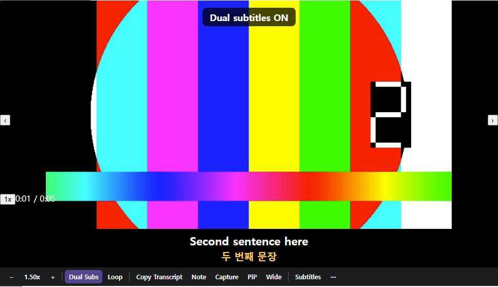
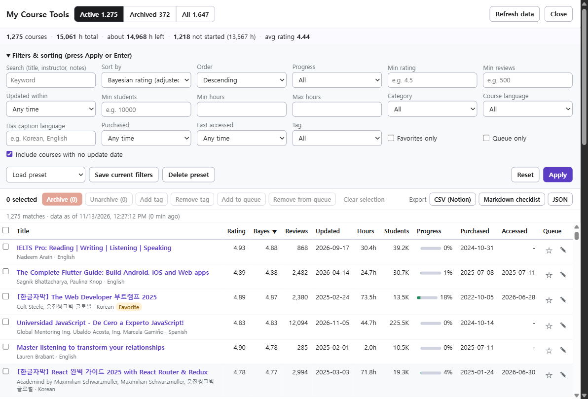
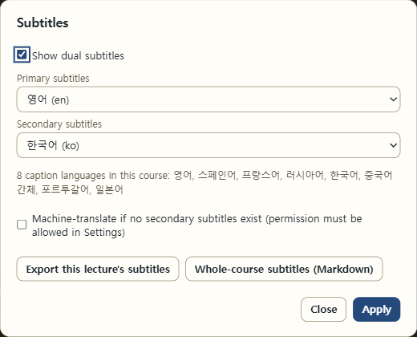
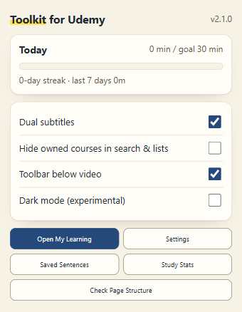
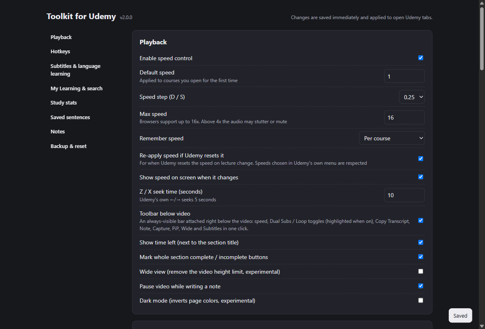

# Toolkit for Udemy

[한국어](README.md) · **English**

An unofficial Chrome extension (Manifest V3) that improves Udemy's My Learning page, the lecture player, and the search and course landing pages. Plain JavaScript, no build step.

> **Not affiliated with Udemy.** This is an independent tool. "Udemy" is a trademark of Udemy, Inc.

## Screenshots

These are real Udemy screens with the extension turned on. The header that shows account information is cropped out, and the lecture video frame is blurred for copyright reasons.

**Toolbar below the video and dual subtitles.** Udemy's own captions (Korean here) are hidden, and the English original plus the Korean translation are shown together over the video. The toolbar sits right under the video. Dual Subs, Loop and Wide turn on and off with one click, and the active ones are highlighted.



**My Course Tools.** Sort and filter hundreds or thousands of courses on My Learning, add tags, build a study queue, archive in bulk, and export (the screenshot is from an account with 1,275 courses).



| Subtitles menu | Toolbar popup |
|---|---|
|  |  |

**Settings page**



## Features

Button names are in English. You can turn every feature on or off in Settings (toolbar icon → Settings).

### Lecture player

A **toolbar** is attached right below the video. It is always visible and never covers the video. It disappears in fullscreen, but the hotkeys keep working.

| Feature | What it does | How to use it |
|---|---|---|
| **Speed** | 0.25x to 16x. The speed is remembered per course (or shared across all courses, in Settings), and re-applied if Udemy resets it when the lecture changes. Speeds chosen in Udemy's own menu are respected. The new speed is briefly shown on screen. | −, + and the speed number on the toolbar (click the number to toggle 1x ↔ the previous speed). Keys D / S / R |
| **Dual Subs** | Shows two subtitle languages at once (primary + secondary). If Udemy shows its captions in a band under the video, the extension replaces that band with a box; if the captions are inside the video, it hides them and shows the two lines over the video. Machine translation can fill in a missing secondary language (off by default). Font size, position (drag the subtitles over the video), background opacity, and whether to show the primary and secondary lines are set in Settings. | Dual Subs on the toolbar (highlighted when on). Key V |
| **Subtitles** | Choose the primary and secondary languages, turn on machine translation, export this lecture's subtitles (TXT, SRT or Markdown, original only or dual), or export the whole course's subtitles as one Markdown file. | Subtitles on the toolbar |
| **Loop** | Repeats the current sentence. Press again to stop. | Loop on the toolbar. Key L |
| Sentence tools | Replay the current sentence, copy it, or save it to your sentence collection (original + translation + source). Saved sentences are exported from Saved sentences in Settings as a TSV for Anki or as CSV. | Keys Q / Y / K |
| **Copy Transcript** | Copies the whole transcript of this lecture to the clipboard in one go. Subtitles do not have to be on, and translations are not mixed in. | Copy Transcript on the toolbar |
| **Note** | Adds a note stamped with the current time (pausing the video while you write can be turned off). Notes are stored only in this browser. Clicking a note in the list jumps to that time, and the list can be copied or saved as Markdown. | Note on the toolbar. Key Alt+N. The list is under ⋯ → View / export my notes |
| **Capture** | Captures the current video frame to the clipboard; use Save as file in the toast to save it. DRM-protected video may capture as a black frame. | Capture on the toolbar. Key Alt+S |
| **PiP** | Pops the video out into a small window. Watch time is still recorded during PiP. | PiP on the toolbar. Key Alt+P |
| **Wide** | Removes the video height limit so the video uses more of the screen (experimental). | Wide on the toolbar. Key Alt+T |
| Time left | Shows the time left, converted to your playback speed, at the top left of the video (on hover) and next to each curriculum section title. Click it for a per-section table. | Automatic |
| Section buttons | Adds Mark section complete / Mark all incomplete buttons to each curriculum section to change its lecture checkboxes in one click. | Curriculum sections |
| Lecture navigation | Go to the next or previous lecture. | Keys N / P |
| **⋯** | One menu for the notes list, time left by section, subtitle exports, Wide on/off, shortcut help and Settings. | ⋯ on the toolbar |

### My Learning

The **My Course Tools** button at the bottom right opens a panel for working with all of your courses (thousands are fine).

| Feature | What it does |
|---|---|
| Sorting | Bayesian rating (adjusted for review count), rating, reviews, last updated, students, duration, progress, purchase date, last accessed, first published, title |
| Filters | Progress, minimum rating / reviews / students, duration range, updated within, category, course language, caption language, purchase date, last accessed, favorites, study queue, tags. Set the conditions and press **Apply** (or Enter); save them with **Save current filters** as a preset. |
| Views | Active / Archived / All tabs, and a summary (course count, total hours, hours left, not-started count, average rating, top categories) |
| Bulk actions | Archive / Unarchive, add or remove tags, add to or remove from the study queue for the selected courses. Each course can also have its own tags and notes. |
| Export | CSV (for Notion import), Markdown checklist, JSON |
| Card badges | Adds rating, duration, update date and student count, plus a Queue marker, to Udemy's own course cards. |
| Archive without reload | Handles the card menu's "Archive" without reloading the page, with an **Undo** button in the toast. |
| Data refresh | **Refresh data** reloads the full course list. The automatic refresh interval (6 hours to 7 days) is set in Settings. |

### Search and course pages

| Feature | What it does |
|---|---|
| "Owned" badge | Marks courses you already own in search results and course lists, so you do not buy a course twice. |
| Hide owned courses | Hides the courses you own in search results (can also be switched in the popup). |
| Landing page info box | Shows on a course page whether you own it, the first published date, last update, video length, review count, and the caption languages. |

### Study stats, popup and settings

| Feature | What it does |
|---|---|
| Study stats | Records only the time the video is actually playing (with the tab visible, or in PiP). Daily goal, goal streak, a 14-day chart, time by course for the last 7 days, and CSV export. |
| Toolbar popup | Today's study time, goal and streak; the speed and time left of the current lecture tab; quick switches (Dual subtitles, Hide owned courses, Toolbar below video, Dark mode); shortcuts to Open My Learning / Settings / Saved Sentences / Study Stats. |
| Check Page Structure | Checks whether a Udemy page change broke a feature. It shows what it found (✓) and could not find (✗), how dual subtitles are placed, and the structure around the video, and you can copy it with **Copy Result**. |
| Settings | Options for speed, dual subtitles, the toolbar, My Learning, search and study stats, plus remapping hotkeys (a warning is shown if a key clashes with Udemy's own). Keys are matched by position, so they also work with a non-Latin input method on. |
| Backup and reset | Export and import settings, notes, saved sentences, tags, study queue, presets, study stats and per-course speeds as JSON. Clear the course-list cache, or reset settings to defaults. |
| Dark mode | Inverts page colors (experimental). |

### Hotkeys (lecture page, changeable in Settings)

| Key | Action | Key | Action |
|---|---|---|---|
| D / S | Speed + / − | R | 1x ↔ previous speed |
| Z / X | Seek back / forward 10 s | N / P | Next / previous lecture |
| V | Dual Subs on/off | L | Loop sentence |
| Q | Replay sentence | Y | Copy sentence |
| K | Save sentence | Alt+N | Note |
| Alt+S | Capture | Alt+P | PiP |
| Alt+T | Wide view | H | Shortcut help |

Udemy's own keys (Space, ←/→ 5 s, Shift+←/→ speed, ↑/↓, F, M, B, ?) keep working. Alt+Shift+P (play/pause), Alt+Shift+←/→ and Alt+Shift+S (capture) work even outside the tab and can be changed at `chrome://extensions/shortcuts`.

### What is not included

Video downloading, completing a whole course at once to get a certificate, and coupon crawling are left out because of terms-of-service and DRM concerns.

## Repository layout

| Path | Contents |
|---|---|
| `udemy-toolkit/` | The extension itself. Load this folder in Chrome |
| `udemy-toolkit/README.md` | Features, hotkeys, install, limits (Korean) |
| `udemy-toolkit/DESIGN.md` | Which Udemy internal APIs and DOM the extension relies on and how well each is verified, plus review notes (Korean) |
| `tests/` | Tests that load the extension into Chromium against a mock Udemy page and API |
| `docs/` | Web Store checklist and English listing text |

## Install

1. Open `chrome://extensions` and turn on **Developer mode**.
2. Click **Load unpacked** and choose the `udemy-toolkit/` folder.

To update, overwrite the files in the same folder and click the reload icon on `chrome://extensions`.

## Tests

```bash
cd tests
npm install
npx playwright install chromium
npm test            # 59 unit tests + 107 integration tests
npm run shots       # screenshots of the mock pages → tests/shots/
```

## Notes

- The extension uses Udemy's website-internal APIs and page structure, not an official API. If Udemy changes them, some features may stop working. Use **Check Page Structure** in the popup to see which ones.
- Notes, sentences, tags, study stats and the course list are stored only in this browser. Settings (hotkeys and options) may sync to your other computers through your Chrome account. Only if you turn it on, machine translation sends subtitle sentences to Google Translate.
- The extension's own screens (toolbar buttons, settings, popup, notifications) are in English. The design documents (`udemy-toolkit/README.md`, `udemy-toolkit/DESIGN.md`) are in Korean. The backup file marker `udemy-toolkit-kr` is kept so that older backups still import.
