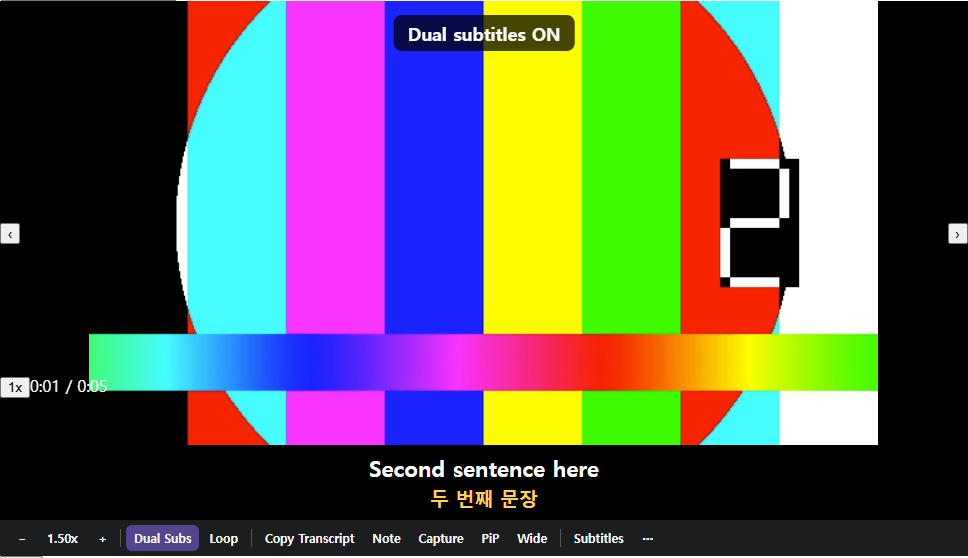
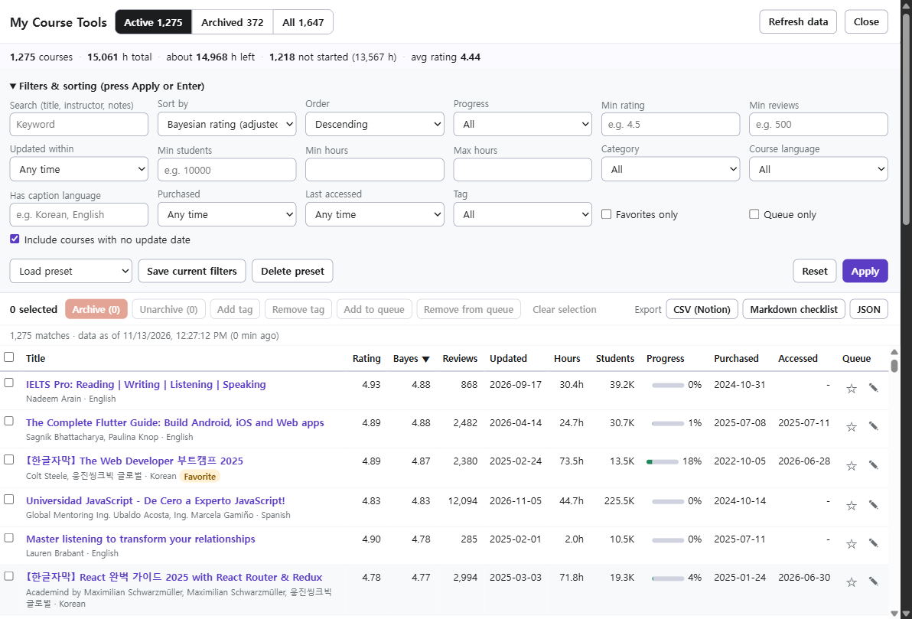
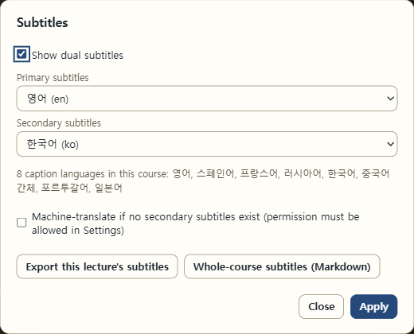
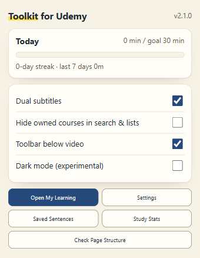
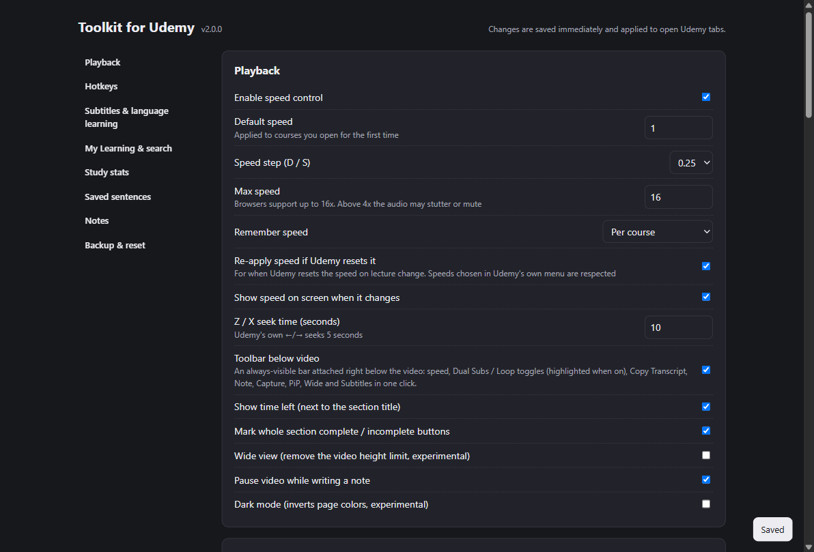
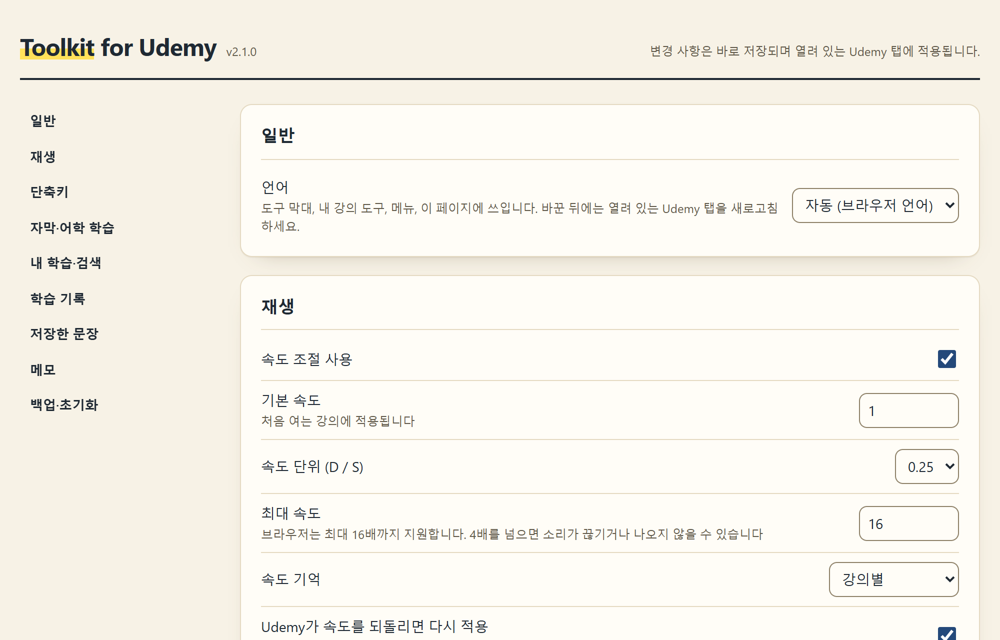
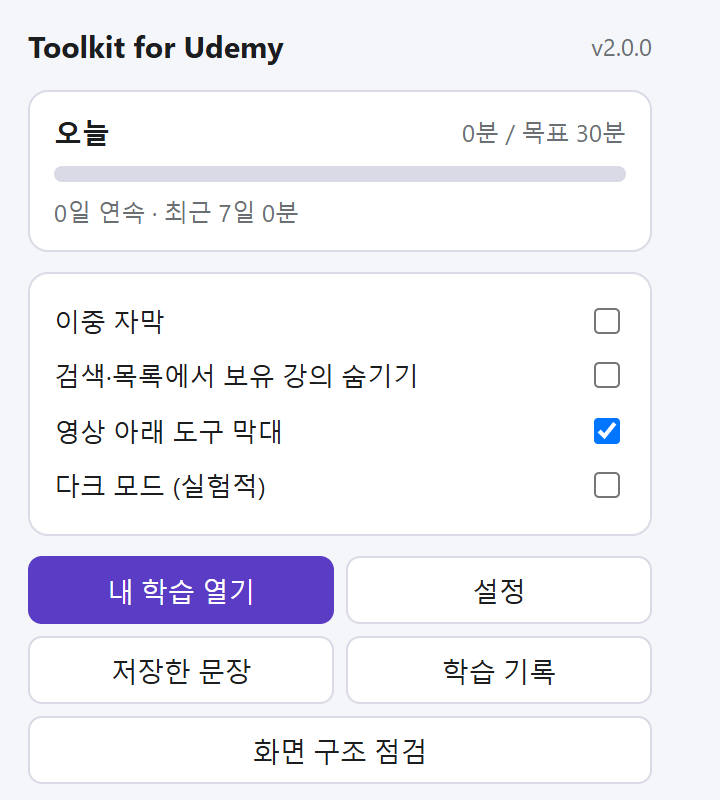

# Toolkit for Udemy

**한국어** · [English](README.en.md)

Udemy 내 학습 페이지, 강의 플레이어, 검색·강의 소개 페이지를 강화하는 개인용 크롬 확장 프로그램(Manifest V3)입니다.
빌드 과정이 없는 순수 JavaScript 구현입니다.

**[Chrome 웹 스토어에서 설치하기](https://chromewebstore.google.com/detail/ckeooonobjmkdpdhijpphdhpploabmbl)** · 문제나 제안은 [GitHub Issues](https://github.com/sikomar00/udemy-toolkit-kr/issues)에 남겨 주세요.

## 스크린샷

아래 그림은 **실제 Udemy 화면**에서 확장을 켜고 직접 찍은 것입니다. 계정 정보가 보이는 머리글은 잘라 냈고, 강의 영상 장면은 저작권 때문에 흐리게 가렸습니다.

**영상 아래 도구 막대와 이중 자막** — Udemy 기본 자막(여기서는 한국어)은 숨기고, 영어 원문과 한국어 번역을 영상 안에 함께 보여 줍니다. 도구 막대는 영상 바로 아래에 붙고, Dual Subs·Loop·Wide는 한 번 클릭으로 켜고 끄며 켜진 것은 색으로 표시됩니다.



**My Course Tools** — 내 학습 페이지에서 수백~수천 개 강의를 정렬·필터하고, 태그·학습 큐·일괄 보관·내보내기를 합니다(그림은 강의 1,275개 계정).



| Subtitles 메뉴 | 툴바 팝업 |
|---|---|
|  |  |

**설정 페이지**



> 이 그림들은 실제 계정 화면을 직접 찍어 `docs/images/`에 넣은 것입니다. 모의 화면용 그림은 `cd tests && npm run shots`로 `tests/shots/`에 만들 수 있습니다(저장소에는 올리지 않음).

**영어 / 한국어 화면** — 브라우저 언어를 따르며, 설정 → 일반 → 언어에서 직접 고를 수 있습니다. 아래는 한국어 화면입니다(위 그림은 영어 화면).

| 설정 페이지 | 툴바 팝업 |
|---|---|
|  |  |

## 기능 설명

화면은 **영어와 한국어**를 지원합니다. 기본은 브라우저 표시 언어를 따르고, 설정(툴바 아이콘 → 설정 → 일반 → 언어)에서 바꿀 수 있습니다. 모든 기능은 설정에서 켜고 끌 수 있습니다.

### 강의 화면 (플레이어)

영상 바로 아래에 **도구 막대**가 붙습니다. 마우스를 올리지 않아도 항상 보이고, 영상 안을 가리지 않습니다. 전체화면에서는 사라지지만 단축키는 그대로 동작합니다.

| 기능 | 설명 | 사용법 |
|---|---|---|
| **배속** | 0.25~16배속. 코스별로 속도를 기억하고(설정에서 "모든 코스 공통"으로 바꿀 수 있음), 강의가 바뀔 때 Udemy가 속도를 되돌리면 다시 적용합니다. Udemy 속도 메뉴로 바꾼 값은 그대로 따릅니다. 속도가 바뀌면 화면에 잠깐 표시됩니다. | 도구 막대의 −, +, 속도 숫자(누르면 1배속 ↔ 이전 속도). 키 D / S / R |
| **Dual Subs** | 자막 두 언어를 동시에 보여 줍니다(원문 + 보조). 영상 아래 Udemy 기본 자막 띠가 있으면 그 자리를 박스로 대체하고, 영상 안에 있으면 기본 자막을 숨기고 영상 위에 보여 줍니다. 보조 자막이 없으면 기계번역을 쓸 수 있습니다(기본 꺼짐). 글자 크기, 위치(영상 위 자막은 끌어서 이동), 배경 진하기, 원문·보조 줄 표시를 설정에서 고릅니다. | 도구 막대 Dual Subs(켜지면 색이 바뀜). 키 V |
| **Subtitles** | 원문·보조 자막 언어 고르기, 기계번역 켜기, 이 강의 자막 내보내기(TXT·SRT·Markdown, 원문만 또는 이중), 코스 전체 자막을 Markdown 한 파일로 내보내기. | 도구 막대 Subtitles |
| **Loop** | 지금 문장을 계속 반복합니다. 한 번 더 누르면 끕니다. | 도구 막대 Loop. 키 L |
| 문장 도구 | 지금 문장 다시 듣기, 복사, 문장 수집함에 저장(원문+번역+출처). 수집한 문장은 설정의 Saved sentences에서 Anki용 TSV나 CSV로 내보냅니다. | 키 Q / Y / K |
| **Copy Transcript** | 이 강의의 원문 대본 전체를 클립보드에 한 번에 복사합니다. 자막을 켜지 않아도 되고, 번역은 섞이지 않습니다. | 도구 막대 Copy Transcript |
| **Note** | 지금 시각이 붙은 메모를 남깁니다(작성 중 영상 일시정지는 설정으로 끌 수 있음). 메모는 이 브라우저에만 저장되고, 목록에서 메모를 누르면 그 시각으로 이동하며, Markdown으로 복사·저장할 수 있습니다. | 도구 막대 Note. 키 Alt+N. 목록은 ⋯ → View / export my notes |
| **Capture** | 지금 영상 화면을 캡처해 클립보드에 복사하고, 토스트의 Save as file로 저장합니다. DRM이 걸린 영상은 검은 화면이 될 수 있습니다. | 도구 막대 Capture. 키 Alt+S |
| **PiP** | 영상을 작은 창으로 띄웁니다. PiP 중에도 학습 시간이 기록됩니다. | 도구 막대 PiP. 키 Alt+P |
| **Wide** | 영상 높이 제한을 풀어 화면을 넓게 씁니다(실험적). | 도구 막대 Wide. 키 Alt+T |
| 남은 시간 | 배속으로 환산한 남은 시간을 영상 왼쪽 위(마우스를 올리면)와 커리큘럼 섹션 제목 옆에 보여 줍니다. 누르면 섹션별 표가 열립니다. | 자동 |
| 섹션 완료 버튼 | 커리큘럼의 섹션마다 Mark section complete / Mark all incomplete 버튼을 붙여 강의 체크박스를 한 번에 바꿉니다. | 커리큘럼 섹션 |
| 강의 이동 | 다음·이전 강의로 이동합니다. | 키 N / P |
| **⋯** | 메모 목록, 섹션별 남은 시간, 자막 내보내기, Wide 켜기/끄기, 단축키 도움말, 설정 열기를 한곳에 모았습니다. | 도구 막대 ⋯ |

### 내 학습 (My Learning)

오른쪽 아래 **My Course Tools** 버튼을 누르면 내 강의 전체(수천 개도 가능)를 다루는 패널이 열립니다.

| 기능 | 설명 |
|---|---|
| 정렬 | 신뢰 별점(리뷰 수 보정), 별점, 리뷰 수, 최근 업데이트, 수강생 수, 강의 시간, 진행률, 구매일, 최근 접속, 최초 출시일, 제목 |
| 필터 | 진행 상태, 최소 별점·리뷰·수강생, 시간 범위, 업데이트 기간, 카테고리, 강의 언어, 자막 언어, 구매 시기, 마지막 접속, 즐겨찾기, 학습 큐, 태그. 선택 상자와 체크박스는 바꾸는 즉시 적용되고, 글자·숫자는 **Apply**(또는 Enter)를 누르면 반영됩니다. **Save current filters**로 프리셋을 저장합니다. 마지막 탭·필터·정렬은 기억해서 다음에 열 때 그대로 보입니다(**Reset**으로 초기화). |
| 보기 | Active / Archived / All 탭, 요약(강의 수, 총 시간, 남은 분량, 미시작 수, 평균 별점, 상위 카테고리) |
| 선택 | 체크박스를 누른 뒤 **Shift+클릭**하면 그 사이 줄이 한꺼번에 선택·해제됩니다. 맨 위 체크박스는 화면에 보이는 줄만 고르고, 조건에 맞는 강의가 더 있으면 **Select all N matching courses** 단추가 나타납니다. |
| 일괄 작업 | 선택한 강의를 Archive / Unarchive, 태그 추가·제거, 학습 큐 추가·제거. 보관이 끝나면 알림의 **Undo**로 되돌릴 수 있습니다. 강의마다 태그·메모를 달 수 있습니다. |
| 내보내기 | CSV(Notion 가져오기용), Markdown 체크리스트, JSON. 고른 강의가 있으면 그것만 내보내고(단추에 `· N selected` 표시), 없으면 필터·정렬 결과 전체를 내보냅니다. |
| 카드 배지 | Udemy 기본 강의 카드에 별점·시간·업데이트·수강생 수와 학습 큐 표시를 붙입니다. |
| 새로고침 없는 보관 | 카드 메뉴의 "보관"을 페이지 새로고침 없이 처리하고, 토스트의 **Undo**로 되돌립니다. |
| 데이터 새로고침 | **Refresh data**로 전체 목록을 다시 받습니다. 자동 갱신 주기는 설정에서 6시간~7일로 고릅니다. |

### 검색·강의 소개

| 기능 | 설명 |
|---|---|
| 보유 중 배지 | 검색 결과와 강의 목록에서 이미 가진 강의에 "Owned" 배지를 붙여 중복 구매를 막습니다. |
| 보유 강의 숨기기 | 검색 결과에서 가진 강의를 숨깁니다(팝업에서도 켜고 끌 수 있음). |
| 강의 소개 정보 상자 | 강의 소개 페이지에 보유 여부, 최초 출시일, 최근 업데이트, 영상 시간, 리뷰 수, 자막 언어 목록을 보여 줍니다. |

### 학습 기록·팝업·설정

| 기능 | 설명 |
|---|---|
| 학습 기록 | 영상이 실제로 재생된 시간만 기록합니다(탭이 보일 때 또는 PiP 중). 하루 목표, 연속 달성일, 최근 14일 그래프, 최근 7일 코스별 시간, CSV 내보내기. |
| 툴바 팝업 | 오늘 학습 시간·목표·연속 달성, 지금 강의 탭의 속도와 남은 시간, 빠른 스위치(Dual subtitles, Hide owned courses, Toolbar below video, Dark mode), Open My Learning / Settings / Saved Sentences / Study Stats 바로가기. |
| Check Page Structure | Udemy가 화면을 바꿔 기능이 멈췄는지 확인합니다. 찾은 것(✓)과 못 찾은 것(✗), 이중 자막 방식, 영상 주변 구조를 보여 주고 **Copy Result**로 복사할 수 있습니다. |
| 설정 | 배속·이중 자막·도구 막대·내 학습·검색·학습 기록 옵션과 단축키 바꾸기(Udemy 기본 키와 겹치면 경고). 한글 입력 상태에서도 키 위치로 동작합니다. |
| 백업·초기화 | 설정·메모·문장 수집함·태그·학습 큐·프리셋·학습 기록·코스별 속도를 JSON으로 내보내고 가져옵니다. 강의 목록 캐시 삭제, 설정 기본값으로 되돌리기. |
| 다크 모드 | 페이지 색을 반전합니다(실험적). |

### 단축키 (강의 화면, 설정에서 변경 가능)

| 키 | 기능 | 키 | 기능 |
|---|---|---|---|
| D / S | 속도 + / − | R | 1배속 ↔ 이전 속도 |
| Z / X | 10초 뒤로 / 앞으로 | N / P | 다음 / 이전 강의 |
| V | Dual Subs 켜기/끄기 | L | 문장 반복 |
| Q | 문장 다시 듣기 | Y | 문장 복사 |
| K | 문장 수집함에 저장 | Alt+N | 메모 |
| Alt+S | 화면 캡처 | Alt+P | PiP |
| Alt+T | Wide 보기 | H | 단축키 도움말 |

Udemy 기본 키(Space, ←/→ 5초, Shift+←/→ 속도, ↑/↓, F, M, B, ?)는 그대로 동작합니다. 탭 밖에서도 쓰는 Alt+Shift+P(재생/정지), Alt+Shift+←/→, Alt+Shift+S(캡처)는 `chrome://extensions/shortcuts`에서 바꿉니다.

### 접근성

My Course Tools 패널, 대화상자, 알림, 팝업, 설정 화면은 키보드와 스크린리더로 쓸 수 있게 다듬었습니다.

- 패널과 대화상자는 이름이 있는 대화상자로 열리고, 열면 키보드 초점이 안으로 들어오며 Tab이 밖으로 나가지 않습니다. Esc로 닫으면 초점이 원래 자리로 돌아옵니다.
- 체크박스, 큐, 편집 단추는 강의 제목이 들어간 이름을 갖고, 정렬 머리글은 Enter나 Space로 누를 수 있으며 정렬 상태를 알려 줍니다.
- 알림은 스크린리더가 읽고(오류는 즉시), 단축키로 켜고 끈 결과도 화면 표시와 함께 읽힙니다.
- 글자 색 대비는 WCAG AA(4.5:1)를 테스트로 확인합니다(패널, 대화상자, 팝업, 설정의 밝은·어두운 화면). 키보드 초점 표시를 항상 보이게 하고, 운영체제의 "움직임 줄이기" 설정을 따릅니다.

### 넣지 않은 기능

영상 다운로드, 코스 전체를 한 번에 완료 처리해 수료증을 받는 기능, 쿠폰 크롤링은 약관·DRM 문제로 넣지 않았습니다.

## 구성

| 경로 | 내용 |
|---|---|
| `README.en.md` | 이 문서의 영어 버전 |
| `udemy-toolkit/` | 확장 프로그램 본체. 이 폴더를 크롬에 로드합니다 |
| `udemy-toolkit/README.md` | 기능, 단축키, 설치, 한계 |
| `udemy-toolkit/DESIGN.md` | 사용한 Udemy 내부 API·DOM의 근거 등급(실측 / 코드 / 추정), 리뷰 반영 내역 |
| `tests/` | 모의 Udemy 페이지·API로 확장을 Chromium에 올려 검증하는 테스트 |

## 설치

1. `chrome://extensions`에서 **개발자 모드**를 켭니다.
2. **압축해제된 확장 프로그램을 로드합니다**로 `udemy-toolkit/` 폴더를 선택합니다.

## 테스트

```bash
cd tests
npm install
npx playwright install chromium
npm test            # 단위 80개 + 통합 170개 (영어 144 + 한국어 26)
npm run shots       # 화면 캡처 → tests/shots/
```

## 주의

- 개인정보 처리 방식은 [개인정보처리방침](docs/privacy-policy.md)(영어, 한국어 요약 포함)에 있습니다. 웹 스토어 등록 절차는 [등록 튜토리얼](docs/web-store-tutorial.md)을 보세요.
- Udemy 공식 API가 아닌 웹사이트 내부 API와 화면 구조를 사용하므로, Udemy가 구조를 바꾸면 일부 기능이 멈출 수 있습니다.
- 메모·문장·태그·학습 기록·강의 목록은 이 브라우저 안에만 저장됩니다. 설정(단축키·옵션)은 크롬 동기화로 같은 계정의 다른 PC와 공유될 수 있습니다. 사용자가 켠 경우에 한해 기계번역만 자막 문장을 외부(구글)로 전송합니다.

> **화면 언어:** 확장 프로그램의 화면(도구 막대 버튼, 설정, 팝업, 알림)은 영어와 한국어를 지원합니다. 언어를 바꾼 뒤에는 열려 있는 Udemy 탭을 새로고침하세요. 강의 제목·자막·메모 같은 내 글과 "화면 구조 점검" 결과(개발자용)는 번역하지 않습니다. 설명 문서(이 파일, DESIGN.md, docs/)는 한국어입니다. 백업 파일의 식별값 `udemy-toolkit-kr`은 이전 백업과 호환되도록 그대로 둡니다.

## 라이선스

[MIT](LICENSE). Udemy 상표와 강의 콘텐츠는 이 라이선스에 포함되지 않습니다.
